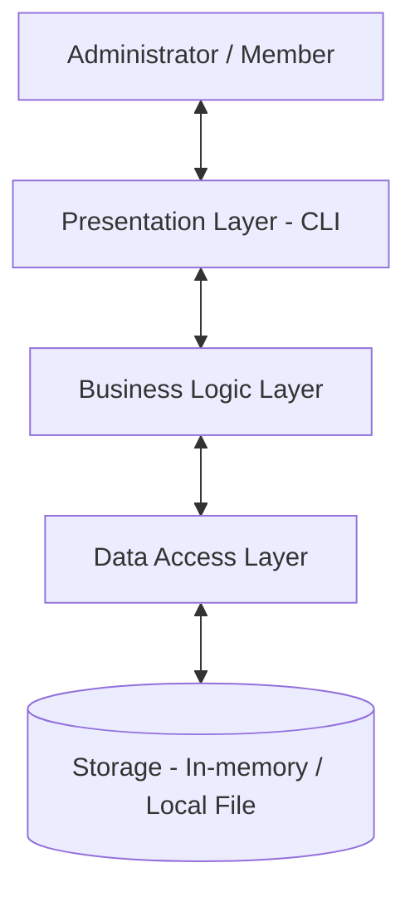

# Software Architecture Design
## Library Management System

### 1. Objective
To define the high-level architecture and component responsibilities of the Library Management System.

### 2. Architecture Style
The system follows a three-layer architecture.

### 3. Layers

#### 3.1 Presentation Layer
- Displays menus and system messages.
- Accepts user input.
- Displays search results and transaction status.
- Sends requests to the business logic layer.

#### 3.2 Business Logic Layer
- Validates book and member information.
- Manages book and member operations.
- Checks book availability before issuing.
- Processes book issues and returns.
- Applies borrowing rules and calculates due dates.

#### 3.3 Data Access Layer
- Stores and retrieves book records.
- Stores and retrieves member records.
- Records borrowing transactions.
- Updates book availability.
- Provides data to the business logic layer.

### 4. Architectural Diagram

### 5. Data Flow
1. A user selects an operation through the presentation layer.
2. The presentation layer sends the request to the business logic layer.
3. The business logic layer validates the request and applies rules.
4. The data access layer reads or updates the required records.
5. The result is returned to the presentation layer and displayed to the user.

### 6. Design Advantages
- Separation of responsibilities.
- Easier testing of business rules.
- Easier maintenance and debugging.
- Storage can be changed without rewriting the entire interface.
- New features can be added with fewer changes to unrelated components.

### 7. Conclusion
The three-layer architecture separates the user interface, business rules, and data operations. This provides a clear foundation for implementing and testing the Library Management System.
